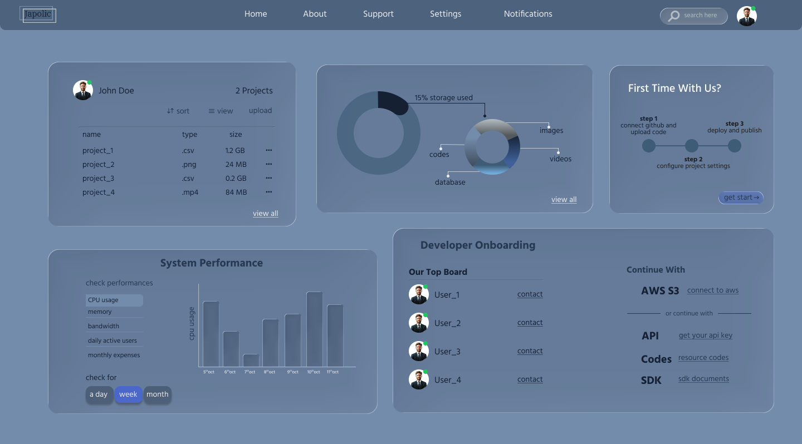
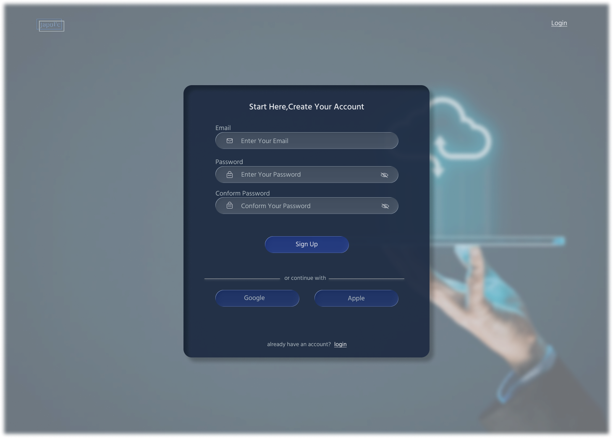
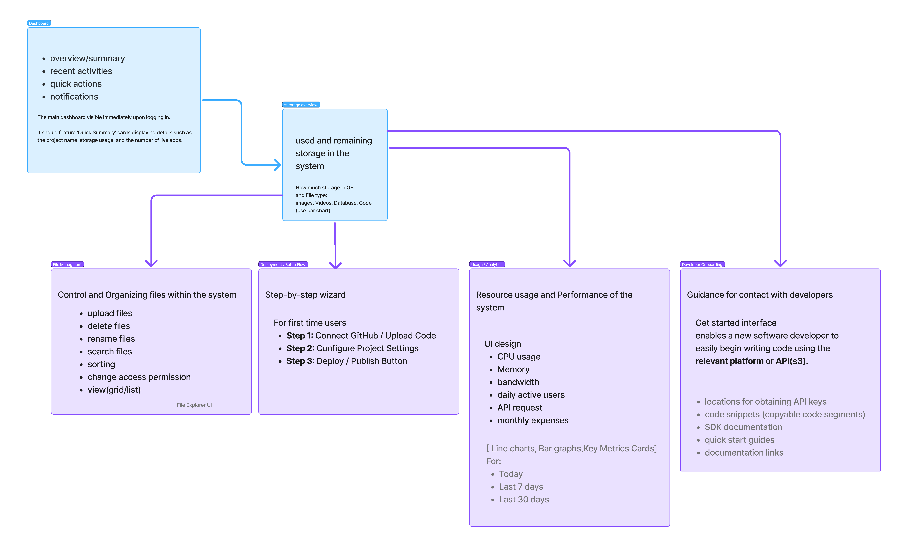

# Japolic – Cloud Platform Dashboard (UI/UX Design)

> A glassmorphism-style SaaS dashboard concept that brings cloud storage, file management, deployment and performance monitoring into one clean, easy-to-use interface.

**Role:** UI/UX Designer
**Type:** Personal design project
**Tool:** Figma
**Focus:** SaaS Dashboard · Information Architecture · Data Visualization · Developer Onboarding

🎨 **Figma Community File:** [View the design in Figma]https://www.figma.com/community/file/1691182784372602574/high-performance-file-system?q_id=450636fb-14e7-4a9d-9f7f-de81bcb3b7c9)

---

## Overview

Cloud platforms are powerful, but their interfaces can feel overwhelming, especially for people who are new to them. Japolic is a SaaS dashboard concept that simplifies the experience by putting the things users need most in one place: their files, their storage, their system performance, and a guided way to get started.

The design uses a calm blue palette, soft glass-like cards and clear hierarchy so complex AWS-style infrastructure data stays easy to scan.

---

## The Problem

- Cloud dashboards are often complex and intimidating for first-time users
- Storage, files, performance and billing information are scattered across different screens
- New developers do not know where to start (API keys, SDKs, deployment steps)
- Non-technical managers need quick answers, such as usage and monthly expenses, without reading raw metrics

---

## The Solution

One dashboard that connects everything, planned first as an information architecture and then designed screen by screen.

| Area | What it does |
|------|--------------|
| **Dashboard** | Overview, recent activities, quick actions and notifications right after login |
| **Storage Overview** | Shows used and remaining storage in GB, split by file type (images, videos, database, code) |
| **File Management** | Upload, delete, rename, search, sort, change access permission, and switch between grid and list view |
| **Deployment / Setup Flow** | Step-by-step wizard for first-time users: connect GitHub / upload code → configure project settings → deploy and publish |
| **Usage / Analytics** | CPU usage, memory, bandwidth, daily active users, API requests and monthly expenses, viewable by day, week or month |
| **Developer Onboarding** | Helps new developers start quickly with API keys, code snippets, SDK documentation, quick start guides and AWS S3 connection |

---

## Screens

### Sign Up
A focused sign-up screen with email and password fields (with show/hide password), a clear primary action, and quick sign-up with Google or Apple. A cloud-themed blurred background keeps attention on the form.

### Main Dashboard
- **File panel:** user profile, project count, and a file table (name, type, size) with sort, view and upload actions
- **Storage card:** donut chart showing the percentage of storage used and a breakdown by images, videos, codes and database
- **"First Time With Us?" card:** a three-step guide with a "get start" action
- **System Performance:** selectable metrics (CPU usage, memory, bandwidth, daily active users, monthly expenses) with a bar chart and day / week / month filters
- **Developer Onboarding:** top board with contact links, plus quick access to AWS S3, API keys, code resources and SDK documents

---

## Design Highlights

- **Information architecture first:** the structure was planned before the visuals, so every screen has a clear purpose
- **Glassmorphism cards:** soft, translucent cards on a blue background give depth without clutter
- **Clear information hierarchy:** the most important information (storage, performance) is prominent
- **Guided first-time experience:** a simple 3-step flow reduces the learning curve
- **Flexible time ranges:** performance data can be viewed for a day, a week or a month
- **Consistent, reusable components:** cards, buttons and inputs share one visual style

# Japolic – Cloud Platform Dashboard (UI/UX Design)

> A glassmorphism-style SaaS dashboard concept that brings cloud storage, file management, deployment and performance monitoring into one clean, easy-to-use interface.

**Role:** UI/UX Designer
**Type:** Personal design project
**Tool:** Figma
**Focus:** SaaS Dashboard · Information Architecture · Data Visualization · Developer Onboarding

🎨 **Figma Community File:** [View the design in Figma](https://www.figma.com/community/file/1691182784372602574/high-performance-file-system?q_id=450636fb-14e7-4a9d-9f7f-de81bcb3b7c9)

---

## Overview

Cloud platforms are powerful, but their interfaces can feel overwhelming, especially for people who are new to them. Japolic is a SaaS dashboard concept that simplifies the experience by putting the things users need most in one place: their files, their storage, their system performance, and a guided way to get started.

The design uses a calm blue palette, soft glass-like cards and clear hierarchy so complex AWS-style infrastructure data stays easy to scan.

---

## The Problem

- Cloud dashboards are often complex and intimidating for first-time users
- Storage, files, performance and billing information are scattered across different screens
- New developers do not know where to start (API keys, SDKs, deployment steps)
- Non-technical managers need quick answers, such as usage and monthly expenses, without reading raw metrics

---

## The Solution

One dashboard that connects everything, planned first as an information architecture and then designed screen by screen.

| Area | What it does |
|------|--------------|
| **Dashboard** | Overview, recent activities, quick actions and notifications right after login |
| **Storage Overview** | Shows used and remaining storage in GB, split by file type (images, videos, database, code) |
| **File Management** | Upload, delete, rename, search, sort, change access permission, and switch between grid and list view |
| **Deployment / Setup Flow** | Step-by-step wizard for first-time users: connect GitHub / upload code → configure project settings → deploy and publish |
| **Usage / Analytics** | CPU usage, memory, bandwidth, daily active users, API requests and monthly expenses, viewable by day, week or month |
| **Developer Onboarding** | Helps new developers start quickly with API keys, code snippets, SDK documentation, quick start guides and AWS S3 connection |

---

## Screens

### Sign Up
A focused sign-up screen with email and password fields (with show/hide password), a clear primary action, and quick sign-up with Google or Apple. A cloud-themed blurred background keeps attention on the form.

### Main Dashboard
- **File panel:** user profile, project count, and a file table (name, type, size) with sort, view and upload actions
- **Storage card:** donut chart showing the percentage of storage used and a breakdown by images, videos, codes and database
- **"First Time With Us?" card:** a three-step guide with a "get start" action
- **System Performance:** selectable metrics (CPU usage, memory, bandwidth, daily active users, monthly expenses) with a bar chart and day / week / month filters
- **Developer Onboarding:** top board with contact links, plus quick access to AWS S3, API keys, code resources and SDK documents

---

## Design Highlights

- **Information architecture first:** the structure was planned before the visuals, so every screen has a clear purpose
- **Glassmorphism cards:** soft, translucent cards on a blue background give depth without clutter
- **Clear information hierarchy:** the most important information (storage, performance) is prominent
- **Guided first-time experience:** a simple 3-step flow reduces the learning

---

## Design Process

1. **Define the user:** first-time developers and non-technical managers using a cloud platform
2. **Map the information architecture:** Dashboard → Storage Overview → File Management, Deployment Flow, Analytics, Developer Onboarding
3. **Design the key screens:** sign up and the main dashboard
4. **Visualize the data:** donut chart for storage, bar chart for performance, simple file table
5. **Refine:** spacing, typography, colors and component consistency in Figma

---

## Tools

| Area | Tools |
|------|-------|
| Design | Figma |
| Techniques | Information Architecture, Components, Auto Layout, Data Visualization |
| Domain | Cloud storage, deployment and monitoring (AWS S3, APIs, SDKs) |

---

## Key Learnings

- Planning the information architecture first makes the visual design faster and more focused.
- Complex cloud data becomes approachable when it is grouped by what the user is trying to do.
- Guided onboarding is just as important as the dashboard itself for first-time users.

---

## About Me

I'm **Chamoda Manamperi**, a UI/UX designer and front-end developer who also works with cloud infrastructure.

🔗 [GitHub](https://github.com/ChamodaManamperi) · [LinkedIn](www.linkedin.com/in/chamoda-manamperi) · [Behance](https://www.behance.net/gallery/256962209/AWS-Cloud-Monitoring-SaaS-Dashboard) · [Dribble](https://dribbble.com/shots/27801740-Cloud-Monitoring-Dashboard)